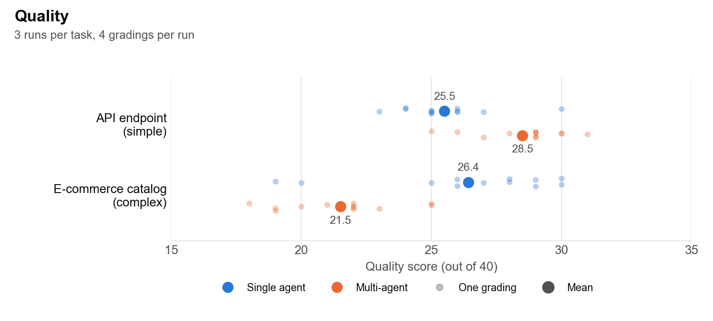
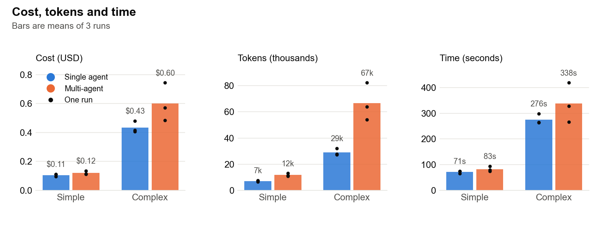

# Single vs. Multi-Agent Decomposition for Coding Tasks

When an AI agent is given a software task, is it better to have one agent complete the entire task, or to split the task into subtasks handled by separate agents? We compare the two options on a simple and a complex full-stack task.

## Motivation

In most engineering teams, complex problems are divided among engineers for efficiency and context reasons. A product team might have one group build the backend and another the frontend. They agree on a contract up front, work in parallel, and then test the system end to end.

While this is changing, AI coding agents are typically used one at a time instead. That has two potential downsides:

1. A single agent may be slower when a task could be parallelized.
2. A single agent can run out of tokens, both context and output, on larger tasks.

An orchestrator that splits a task across several agents could address both. In this experiment, we test whether it helps on representative tasks, and what it costs.

## Summary

- On the simple task (one API endpoint), multi-agent scored higher in all three runs (28.5 vs 25.5 out of 40 on average). It cost 14% more and took slightly longer.
- On the complex task (e-commerce catalog), the single agent scored higher in two of three runs (26.4 vs 21.5 on average). The third was a tie, and it was the run where the single agent's answer was cut off. Multi-agent's biggest weakness was consistency between its parts: 4.6 vs 7.7 out of 10.
- On the complex task, multi-agent also used 2.3x the tokens and cost 38% more.
- Multi-agent was slower on both tasks, because the sub-agents took turns rather than running at the same time.

This is a small study: two tasks, three runs each, graded by an LLM.

## Setup

### Tasks

Both tasks ask for a full-stack implementation with a Python/Flask backend and a TypeScript frontend. The full prompts are in [`tasks.json`](tasks.json), which also defines three tasks not used here (see Extensions).

- API endpoint (simple): implement `GET /api/user/preferences`, with authentication, error handling, and backend and frontend code.
- E-commerce catalog (complex): a product catalog with a database schema, search with filters, recommendations, an admin dashboard, public product pages, cart integration and image upload.

### Approaches

We run both approaches with Claude Sonnet 4.5 and the same task prompt.

- Single agent: one call with extended thinking (a 10,000-token thinking budget and a 32,000-token output limit).
- Multi-agent: an orchestrator first splits the task into subtasks with dependencies ([`src/auto_orchestrator.py`](src/auto_orchestrator.py)). Each sub-agent then gets its subtask and access to what the other sub-agents have written so far. After every step, it declares itself complete, in progress or blocked. Each sub-agent call is limited to 16,000 output tokens.
  - API endpoint: split into backend, then frontend, in every run.
  - E-commerce: split into backend, then admin dashboard and storefront, in every run.

Every sub-agent finished in its first turn, so in practice this ran as a single pass: backend first, then the frontends.

### Grading

We grade each run's two outputs side by side with Claude Opus 5.5 ([`src/grade_pairwise.py`](src/grade_pairwise.py)). The grader scores four criteria from 1 to 10: completeness, correctness, code quality, and consistency between components.

To reduce grader bias:
- The grader sees both outputs in full.
- The approach names are removed.
- Each pair is graded twice with the single agent's output first and twice with the multi-agent output first.

That gives 12 gradings per task (3 runs x 4 gradings).

## Results

### Quality



On the simple task, multi-agent scored higher. Most of this difference came from correctness (6.2 vs 4.5) and consistency (8.2 vs 6.8). The single agent was rated more complete (8.1 vs 7.2).

On the complex task, the single agent scored higher. The gap is mostly consistency (7.7 vs 4.6). The admin dashboard and storefront sub-agents each built against the backend on their own. The grader found mismatches between the parts: response shapes and image paths that differed between backend and frontend, and two frontends that stored login tokens differently.

We graded each pair with each output shown first. The same approach came out ahead either way, but the order changed the size of the gap. On the complex task, the single agent led by 8.5 points when shown first and only 1.3 when shown second. Individual gradings also varied a lot, with the single agent's e-commerce scores ranging from 19 to 30. To reduce noise, we average the 12 gradings.

### Cost, tokens and time



| | Single agent | Multi-agent |
|---|---|---|
| Simple: cost / tokens / time | $0.11 / 7.2k / 71s | $0.12 / 11.8k / 83s |
| Complex: cost / tokens / time | $0.43 / 29.1k / 276s | $0.60 / 66.7k / 338s |

Multi-agent uses more tokens because each sub-agent re-reads the task and the other sub-agents' output. It was slower because the sub-agents ran one after another.

In both tasks the frontend depended on the backend, so the simple task had nothing that could run at the same time. On the complex task, the admin dashboard and storefront could have overlapped.

## Extensions

- Run independent sub-agents, like the admin dashboard and storefront, at the same time. The logged timings suggest this would make multi-agent 5-30% faster than the single agent on the complex task.
- Add a best-of-N baseline: several independent single-agent attempts for the same budget as multi-agent, keeping the best one. This would test whether multi-agent's advantage comes from splitting the task or just from spending more.
- Run more tasks of varying complexity, to see where the advantage flips. Three more are already defined in [`tasks.json`](tasks.json) but not yet run: an authentication system and payment integration (medium) and an analytics dashboard (complex).

## Limitations

- The sample is small, with two tasks and three runs each.
- The grader is an LLM. Individual gradings vary by several points, and it didn't run the code. Absolute scores matter less than the comparison between approaches.
- The multi-agent output still refers to "subtasks", so a grader could tell which approach produced it even with the names hidden.
- One of the three single-agent e-commerce answers still hit its 32,000-token limit and was cut off.
- Only the single agent used extended thinking; the sub-agents didn't.
- Sub-agents also get extra instructions to keep to a minimum viable implementation, which the single agent doesn't.
- The orchestrator prompt's examples name these two task types, which steers how it splits them.

## Reproducing

Requires Python 3.9+ and an Anthropic API key. A full run costs about $10.

```bash
python -m venv .venv && .venv/bin/pip install -r requirements.txt
export ANTHROPIC_API_KEY=...
.venv/bin/python src/run_experiments.py --tasks api_endpoint,ecommerce --runs 3   # agents (~$4)
.venv/bin/python src/grade_pairwise.py --tasks api_endpoint,ecommerce --samples 2  # grading (~$6)
.venv/bin/python src/plot_results.py                                               # charts (free)
```

`run_experiments.py` and `grade_pairwise.py` skip work that already has saved results; pass `--overwrite` to redo it.

## Repository layout

```
tasks.json                    task definitions
src/run_experiments.py        runs the single agent and the multi-agent orchestrator
src/auto_orchestrator.py      multi-agent orchestrator (decomposition + turn-taking sub-agents)
src/grade_pairwise.py         pairwise grader used for the results above
src/plot_results.py           charts
experiments/outputs/          raw agent outputs, one folder per task and run
experiments/evaluations/      grader responses and scores
experiments/figures/          charts
experiments/logs/             console logs from the run
```
